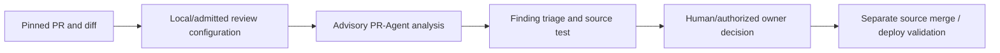

# Fork qualification notes — PR-Agent advisory review

**Scope:** public fork of the open-source PR-Agent reviewer. The reviewer is an advisory component and is not a repository owner, release approver, CI system, runtime executor or Concurrency Ledger participant by default.

For repeatability, bind review to exact PR head, base SHA and changed files; classify findings as reproduced/fixed/rejected-with-evidence/open. A successful no-findings review does not prove correctness or merge safety. When review credentials, API limits or paid quota are unavailable, retain deterministic free/offline static and unit tests rather than silently purchasing or changing services.

This fork is a proposed source for owned portable PR-review tooling; package/release integration requires caller wiring, privileges and live acceptance distinct from repository source.

**Security:** do not publish private PR diff content, tokens, organization policies, confidential files or results from inaccessible repositories. Preserve upstream MIT license and notices.
